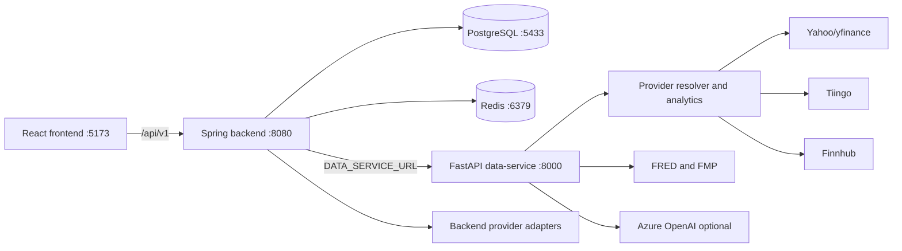

# Finance Project

Finance Project is a brownfield investment research and portfolio
decision-support platform. It combines persistent portfolio/journal/watchlist
workflows with provider-backed market evidence, deterministic analytics, and
optional Azure OpenAI analysis.

The repository is a monorepo with three application runtimes:

- `backend/`: Spring Boot 3.4 and Java 17 public API, domain orchestration,
  PostgreSQL persistence, and Redis caching.
- `data-service/`: FastAPI provider resolution, technical/fundamental/valuation/
  risk/portfolio analytics, and optional AI reasoning.
- `frontend/`: Vite, React, and TypeScript browser application.

## Architecture



The backend follows hexagonal architecture: framework-free domain code reaches
persistence, caches, providers, and the data-service through ports and adapters.
The frontend calls the Spring API for normal application flows. Missing provider
or AI evidence degrades explicitly and is never replaced with fake data.

See:

- [Current-system contract](SPEC.md)
- [Architecture details](docs/spec/current-system/architecture.md)
- [HTTP and browser contracts](docs/spec/current-system/contracts.md)
- [Domain and persistence rules](docs/spec/current-system/domain-and-data.md)
- [Operations and providers](docs/spec/current-system/operations.md)
- [Target product PRD](docs/product/PRD.md)

## Local Ports

| Service | Port |
|---|---:|
| Backend | `8080` |
| Data-service | `8000` |
| Frontend | `5173` |
| PostgreSQL | `5433` |
| Redis | `6379` |
| Prometheus | `9090` |
| Grafana | `3000` |
| MongoDB (configured/reserved) | `27017` |

## Configuration

Copy `.env.example` to `.env` and provide at least the database password required
by your local Compose/backend setup. Provider and AI capabilities are conditional:

```ini
DB_PASSWORD=replace_me
TIINGO_API_KEY=
FINNHUB_API_KEY=
FRED_API_KEY=
FMP_API_KEY=
AZURE_OPENAI_API_KEY=
AZURE_OPENAI_ENDPOINT=
AZURE_OPENAI_DEPLOYMENT_NAME=
AZURE_OPENAI_API_VERSION=2024-05-01-preview
DATA_SERVICE_URL=http://localhost:8000
```

Do not commit `.env` or expose keys to the frontend. Missing optional keys produce
the degradation described in
[operations.md](docs/spec/current-system/operations.md), not synthetic responses.

## Local Development

Start infrastructure and the containerized data-service:

```bash
docker compose up -d
```

Start the backend from `backend/`:

```powershell
.\mvnw.cmd spring-boot:run
```

Start the frontend from `frontend/`:

```bash
npm install
npm run dev
```

Open `http://localhost:5173`.

## Verification

Run checks for every touched runtime:

```powershell
# backend/
.\mvnw.cmd test

# data-service/
python -m pytest

# frontend/
npm run lint
npm run test:coverage
npm run build

# repository root after Compose changes
docker compose config --quiet
```

Frontend routed critical flows and release readiness also require `npm run e2e`.
The full test-only policy and S1-S10 smoke catalog live in
[verification.md](docs/agent/verification.md).

## API Documentation

- Backend Swagger UI: `http://localhost:8080/swagger-ui.html`
- Backend API docs: `http://localhost:8080/api-docs`
- Supporting OpenAPI artifact: [docs/openapi.yaml](docs/openapi.yaml)

## Contribution and Decisions

- [Contribution guide](CONTRIBUTING.md)
- [Agent instructions](AGENTS.md)
- [Documentation map](docs/README.md)
- [Architecture decisions](docs/adr/README.md)
- [Legacy archive manifest](docs/LEGACY_ARCHIVE_MANIFEST.md)
