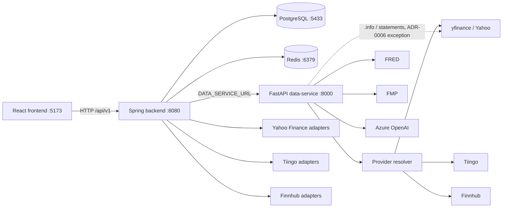
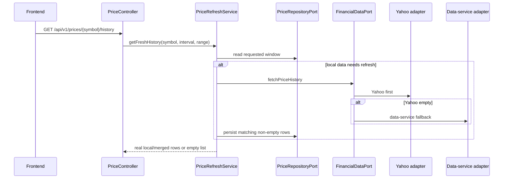
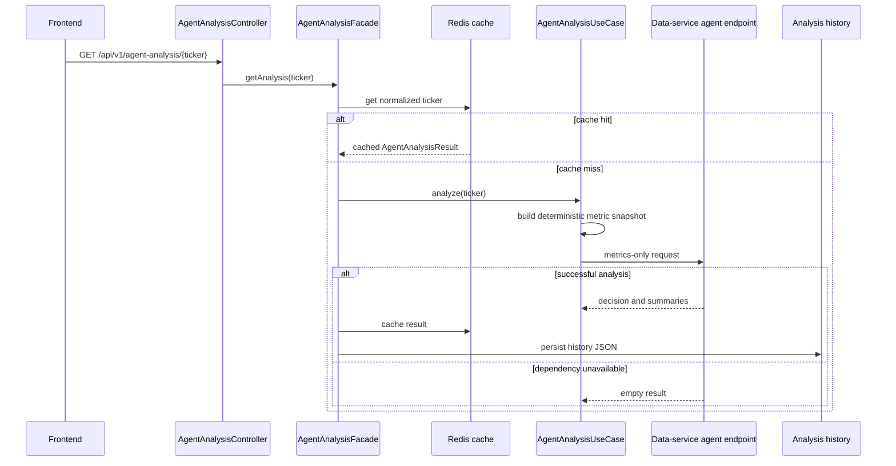

# Current-System Architecture

**Status:** Verified brownfield baseline

**Last verified:** 2026-10-01

This document owns runtime boundaries, component ownership, and cross-service
flows. It describes the implemented system, not the target roadmap.

## Runtime Boundaries

| Runtime | Responsibility | Must not own |
|---|---|---|
| `frontend/` | Browser routing, interaction state, visual composition, and calls to the Spring API | Provider credentials, direct normal-flow calls to the data-service, or server-side financial rules |
| `backend/` | Public `/api/v1` orchestration, domain rules, relational persistence, Redis caching, and provider/data-service adapters | Framework dependencies inside the domain or fabricated fallback data |
| `data-service/` | Provider resolution, quantitative analytics, research calculations, portfolio analytics, and optional Azure OpenAI reasoning | Product persistence or hidden data fetching inside AI agents |

The frontend Axios client defaults to `http://localhost:8080/api/v1`. The Vite proxy
also targets the Spring backend. These are one compatibility boundary and must
change together when API routing changes.

## Backend Hexagonal Boundary

- Framework-free models, ports, and services live under
  `backend/src/main/java/com/ozkaslibasar/financeproject/domain/`.
- Outbound contracts live under `domain/port/outbound`; domain services reach
  persistence, caches, market providers, and the data-service through those
  contracts.
- Spring REST, persistence, client, cache, and scheduler implementations live
  under `adapter/`. Spring configuration lives under `config/`.
- `DomainConfig.java` registers pure domain services as beans. Domain classes do
  not carry Spring, JPA, or Lombok annotations; `ArchitectureTest` enforces these
  dependency restrictions.
- REST controllers translate HTTP and delegate. Scheduled adapters delegate one
  operation; `PriceIngestionJob` currently calls `PriceIngestionService.ingestAll()`.
- MapStruct mappers under adapter packages translate between domain and transport
  or persistence representations where a mapper exists.

## Data-Service Boundary

- `main.py` owns FastAPI application startup, middleware, router registration,
  the provider-chain price endpoint, and Prometheus exposition.
- `app/routers/` owns HTTP translation; `app/services/` owns analytics and
  orchestration; `app/providers/` owns provider-specific access and fallback;
  `app/models/` owns Pydantic request and response contracts.
- Analytics endpoints are read-only. A persistence responsibility requires a
  separately approved architecture change.
- Price history for every route and analytics service is read through
  `MarketDataResolver.get_ohlcv` with an explicit `adjusted` flag (ADR-0006).
  Company `.info` and financial-statement reads in the fundamental, factor, and
  valuation services are recorded direct-yfinance exceptions; do not add new
  direct provider calls. Agent functions receive prepared metrics and narrative
  context only; they do not call providers or tools and do not recalculate
  financial metrics.

## Frontend Boundary

- `frontend/src/main.tsx` mounts `BrowserRouter`; `frontend/src/App.tsx` owns
  application routes, redirects, and the routed shell composition.
- Current data fetching is mixed: reusable hooks own many loading/error flows,
  while `App.tsx` and some large components also call the API directly. This is
  current brownfield behavior, not a claim that the hook migration is complete.
- Transient interaction state such as selected symbols, modals, chart ranges,
  filters, sorting, and drawers remains browser/component state.
- Browser routes and backend endpoints are separate contracts. Adding or changing
  a browser route does not implicitly rename an `/api/v1` endpoint.
- Styling uses the CSS variables defined in `frontend/src/index.css`.
- The five primary Turkish navigation tasks are Bugün (`/dashboard`), Araştır
  (`/workspace`), İzleme Listem (`/watchlist`), Portföy (`/portfolio`), and
  Günlük (`/journal`). Existing deep links remain routable. Route views and
  larger dialogs load on demand through React `lazy` and `Suspense`.
- `/workspace/:symbol` selects the requested symbol when priced history is
  available. A missing symbol or history produces an explicit empty state.
- Araştır composes six tabs in a fixed order: Genel bakış, Grafik,
  Finansallar, Risk, Haberler, AI raporu (`components/research/`). Source
  details open as a nonmodal side panel only at viewport ≥1440px with the data
  area still ≥900px; otherwise as a modal drawer that returns focus.
- Bugün (`DashboardHome`) has a single `h1` and opens with the portfolio
  summary in the order Güncel değer, Maliyet, Fiyat kapsamı, Toplam kâr /
  zarar. When any holding lacks a price, the current total stays `—` and the
  priced subtotal is labelled "Fiyatı bulunan pozisyonların ara toplamı".
- The news page lists only the sources that delivered headlines in the current
  feed; no publisher is shown as a source unless it appears in the feed.
- UI copy is Turkish and uses one state vocabulary: "Yüklenemedi" (request
  failed), "Veri yok" (empty), "Kısmi veri" (partial coverage), "Yetersiz
  geçmiş" (insufficient history). Unknown financial values render as `—`, never
  as `0`. Dialogs (`ManageAssetsDrawer`, `TradingJournalModal`,
  `SettingsModal`, `StockDetailModal`) are named `role="dialog"` elements that
  close with Escape; validation and save results appear inside the dialog
  rather than through browser `alert`/`confirm`/`prompt`. Dates use the `tr-TR`
  locale (for example `9 Tem 2026`); money keeps the `$1,234.56` USD format.
- The seven-value research status vocabulary (`WatchlistResearchStatus`) has one
  UI home: `components/sectionStatus.ts` (labels, styles, `isKnownStatus`) and
  `components/StatusPill.tsx`, shared by `WatchlistsView` and the smart report.
  `StockDetailModal` renders `SmartReportEvidenceNote` above the generated smart
  report body (R-9) and `SmartReportStatusPanel` ("Veri durumu") under it. When the
  overall status is not `OK` or is unknown, the note (`role="note"`) says the score
  rests on incomplete evidence, so it precedes grade and recommendation, which stay
  visible; an absent or `null` `sectionStatus` adds a "Durum bilinmiyor" line and is
  never treated as `OK`. The panel lists per score component the score or "Veri yok",
  the status pill from `sectionStatus.components["<x>_score"]` (camelCase breakdown
  keys map to snake_case `*_score` keys), and the reason code with a visible Turkish
  explanation. Components reported only by `sectionStatus` are listed too, also when
  the breakdown is null. `OK` carries no warning styling; a `null` or unrecognised
  component status shows "Durum bilinmiyor". The status is a data label: not an
  investment signal and never added into the score. A missing analyst price target
  stays `null` (`—`), an absent candle series shows `— mum`, a missing price change
  is neutral-coloured, and the analyst bar is hidden without analyst data.
- `ResearchAgentReport` (AI raporu) reads `decision_status` from `GET /agent-analysis/{ticker}` and shows, inside the
  "Portföy Yöneticisi" section, a `role="note"` only when the status is not `OK`: `FAILED` says "Karar çıktısı
  ayrıştırılamadı; karar gösterilmiyor" with the reason code as small text; an absent, `null` or unrecognised status says
  "Durum bilinmiyor" and is never treated as `OK`. The raw manager text stays visible. `decision` and `confidence` are
  nullable in `AgentAnalysis` and are not rendered; nothing shows them when the status is not `OK`. The status is a data
  label, not an investment signal.
- `TradingJournalView` reads the nullable `priceStatus` and `priceAsOf` of each trade
  (price staleness D-3). `STALE` shows an "Eski fiyat" pill (shared `StatusPill`
  with a local `label`) and the `tr-TR` formatted `priceAsOf` under the profit/loss
  ("—" when the time is missing or invalid); `FAILED`/`EMPTY` show "Fiyat yok"; `OK`,
  `null` or an absent field show nothing extra. Profit/loss and return are rendered
  as sent, never recoloured or recomputed in the browser. The pill is a data label,
  not an investment signal.
- `frontend/src/utils/portfolioValuation.ts` keeps a portfolio total unknown
  when any holding lacks a valid current price. Priced subtotal and coverage
  remain visible as partial evidence; acquisition cost is never substituted
  for a current price.
- The Portföy screen hosts two EPIC-002 panels (`components/portfolio/`), both
  scoped to the active portfolio and calling the Spring API only (R-26):
  - `PortfolioImportPanel` ("CSV ile işlem içe aktar"): choose a `.csv` file,
    upload it as `text/csv` (raw bytes), review the staged counts and the row
    table (row number, status, message, identity), then press "Kabul et". The
    ledger changes only on accept; the button is disabled while the request runs
    and after the batch is `ACCEPTED`. Backend rejections show the `ApiError`
    message; an accepted batch makes the screen reload positions and
    transactions.
  - `PortfolioStatePanel` ("Portföy durumu"): the as-of date input is capped at
    today (UTC) and a later date disables "Durum oluştur". The result shows the
    version (short form, full value in the tooltip), the exposure status, the
    positions with Turkish valuation labels, and the asset-type weights only
    when `exposureStatus` is `COMPLETE`. A `null` price, price date, market
    value or weight renders as `—` with the accessible name and tooltip
    "bilinmiyor", never `0`. `PARTIAL` adds a note that weights are
    withheld because some positions have no usable price or matching currency.
    The version is an identifier, not an investment signal, and no Fit or
    decision flow uses it.
  - The transaction delete flow in `TradingJournalModal` shows the backend `409`
    message (via `ApiError.message`) instead of the generic failure text.
  - Response shapes are pinned by `docs/contracts/fixtures/portfolio-import-batch.json`,
    `portfolio-state-complete.json` and `portfolio-state-partial.json`.

Frontend API access goes through domain modules under `frontend/src/api`
(`assets`, `journal`, `market`, `news`, `portfolio`, `research`, `watchlists`).
`client.ts` is an export-only compatibility barrel, and `http.ts` owns the shared
Axios instance (`apiClient`); `npm run check:api-boundaries` keeps the barrel
export-only and keeps Axios imports out of the domain modules. The base URL comes
from `frontend/src/api/config.ts`: `VITE_API_BASE_URL` when set, otherwise
`http://localhost:8080/api/v1`. A response interceptor converts HTTP and transport
failures into `ApiError` (`frontend/src/api/errors.ts`), whose `message` is the
Spring error body's `message` when present; request cancellations are passed
through unchanged. The `getApiError*` helpers read status, body, and message from
an `ApiError` or a raw HTTP failure.

### Frontend UI and TypeScript conventions

- The repository design decisions and `frontend/src/index.css` tokens guide UI
  implementation. Stitch may be used to explore or review a prototype, but its
  availability does not gate frontend work; generated screens are not production
  source. Compare proposed UI with the approved product foundation, scoped task,
  existing routes, and working frontend before implementation.
- The visual direction is institutional, calm, focused, professional, and highly
  readable. Keep dense financial detail available at the point of investigation
  while making the next user action and evidence quality clear.
- Reuse `frontend/src/index.css` tokens and existing components. Do not introduce
  a competing palette, spacing system, duplicate table/card/formatter, or loading
  pattern without an explicit design reason.
- Keep layouts responsive, validate text overflow at narrow and wide viewports,
  maintain accessible contrast and keyboard-visible focus, and use semantic
  controls for buttons, forms, tabs, menus, and filters.
- Avoid `any`. Keep API responses, props, UI states, and chart inputs explicitly
  typed; use discriminated unions where state variants matter.
- Format locale-sensitive financial display values with `Intl.NumberFormat`
  rather than hand-built separators or currency strings.
- Prefer hooks/API modules for new fetching logic and typed presentational props.
  Existing direct calls in `App.tsx` and large components are brownfield facts,
  not a pattern to expand without a scoped refactor.

## Price Refresh Flow

`PriceRefreshService`, not the controller, owns DB-first refresh behavior. It
normalizes symbols, rejects cross-symbol provider rows, persists only non-empty
matching results, and returns existing real rows when refresh fails.

## Asset Resolution Flow

`AssetController` delegates symbol resolution to `AssetResolutionService`:

1. Normalize the canonical symbol.
2. Read the best usable Yahoo symbol mapping when one exists.
3. Ask `PriceChartClientPort` for provider metadata.
4. Persist `VERIFIED` metadata when the provider succeeds.
5. Persist mapped `PARTIAL` metadata when only a mapping is usable.
6. Otherwise persist a minimal `STOCK` asset with `UNAVAILABLE` metadata status.

Unavailable metadata is explicit evidence, not permission to invent exchange,
currency, name, or provider values.

## Agent-Analysis Flow

Cache lookup belongs to `AgentAnalysisFacade`, while deterministic metric assembly
belongs to `AgentAnalysisUseCase`. The data-service pipeline is strictly:

1. Fundamental Analyst
2. Technical Analyst
3. Risk Analyst
4. Bull Researcher
5. Bear Researcher
6. Portfolio Manager

Azure OpenAI failure produces no synthetic narrative. The backend exposes an
unavailable result rather than manufacturing a decision.

## Accepted Architecture Decisions

- `docs/adr/0001-hexagonal-architecture.md`
- `docs/adr/0002-three-runtime-monorepo.md`
- `docs/adr/0003-redis-agent-analysis-cache.md`
- `docs/adr/0004-sequential-agent-order.md`
- `docs/adr/0005-db-first-lazy-price-loading.md`

## Evidence Anchors

- `backend/src/test/java/com/ozkaslibasar/financeproject/ArchitectureTest.java`
- `backend/src/main/java/com/ozkaslibasar/financeproject/config/DomainConfig.java`
- `backend/src/main/java/com/ozkaslibasar/financeproject/domain/service/PriceRefreshService.java`
- `backend/src/main/java/com/ozkaslibasar/financeproject/domain/service/AssetResolutionService.java`
- `backend/src/main/java/com/ozkaslibasar/financeproject/adapter/inbound/rest/AgentAnalysisFacade.java`
- `data-service/app/trading_agents/metrics_trading_graph.py`
- `frontend/src/App.tsx`
